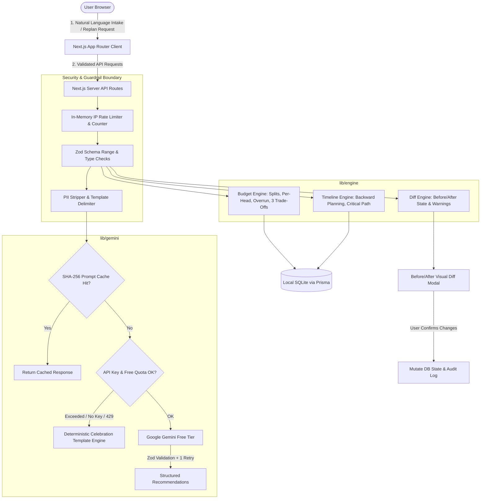

# EventSense (Jashn) — GenAI Celebration Planning Assistant

> **A celebratory, editorial-grade GenAI planning assistant for Indian weddings, milestone birthdays, and community festivals.**  
> Built with Next.js App Router, TypeScript strict, restyled Tailwind UI, Prisma + SQLite, deterministic TypeScript engines, and Google Gemini free-tier with robust offline-first guardrails.

---

## Architecture Diagram



---

## Key Features

1. **Conversational Intake with Contradiction Detection**:
   - Accepts freeform descriptions (e.g., *"Big wedding in Nov, around 2 lakh, 500 guests"*).
   - Flags mathematically unviable plans (₹400/guest vs standard ₹1,200–₹2,500 minimums) and presents clarifying questions before plan creation.
2. **Deterministic Budget Engine (`/lib/engine/budget.ts`)**:
   - Zero LLM math. All percentage splits, cost-per-head, overrun detection, and health states are calculated in pure TypeScript.
   - Interactive Recharts donut visualization.
   - **"Where can I save?"**: 3 trade-offs whose rupee savings are deterministically computed based on exact plate count and venue ratios.
3. **Backward Planning Timeline (`/lib/engine/timeline.ts`)**:
   - Calculates dates backward from celebration day (`T - 180d` to `T - 0d`).
   - Identifies critical path dependencies.
   - Flags compressed timelines (e.g. wedding in <30 days).
   - "This Week" priority action checklist with interactive checkboxes.
4. **Vendor Vetting & Outreach Assistant**:
   - Category-specific vetting questions, red flags, and contract clauses.
   - Quote comparison with tunable weighted scores (Pricing vs Quality vs Responsiveness).
   - AI-drafted WhatsApp and formal email inquiries using client-side placeholders (`{{YourName}}`, `{{VendorName}}`).
5. **Replanning Assistant with Visual Diff Confirmation (AI Rule 4)**:
   - Evaluates changes (e.g., *"Guests increased from 150 to 220"*).
   - Injects new tasks (e.g., *"Update catering contract with +70 plate minimum"*), shifts budget per-head, and warns about venue capacity.
   - **No change is applied without explicit user confirmation in a side-by-side diff modal**.
6. **Ideas & Menus**:
   - Themes, Jain/Vegan dietary menus, decor concepts, and sangeet activities with cost ranges and a one-click "Add to Plan" button.
7. **Stretch Features**:
   - RFC 5545 `.ics` calendar export.
   - Print-CSS stylesheet for PDF export.
   - Cryptographically random 128-bit hex token read-only share link with expiration and instant revocation.

---

## Design System & Typography

- **Editorial Palette**:
  - Warm Parchment background (`#FAF7F2`)
  - Deep Oxblood primary (`#4A0E17`)
  - Marigold accent (`#D97706`)
  - Sage green health indicators (`#5F7A61`)
  - Midnight ink typography (`#1C1917`)
- **Event Theming**:
  - **Wedding**: Oxblood & Heritage Gold
  - **Birthday**: Festive Coral & Pistachio
  - **Community / Diwali**: Deep Teal & Royal Saffron
- **Typography**:
  - Display / Headings: *Fraunces* (Characterful optical serif)
  - Interface / Body: *Instrument Sans* (Humanist sans)
  - Self-hosted via Next.js Font Optimization.

---

## Security Model & Free-Tier Limits

- **Server-Side API Key Only**: `GEMINI_API_KEY` is strictly server-only. Never exposed to browser bundles or client logs.
- **Client-Side PII Scrubbing**: Names, 10-digit Indian mobile numbers (`+91`), emails, and postal addresses are stripped before invoking LLM endpoints.
- **Prompt Injection Defense**: All user text is treated as data inside bounded delimiters (`<user_input>`). Function calling is restricted to an allowlist with Zod-validated arguments.
- **Free-Tier Protection Guards**:
  - In-memory SHA-256 request cache (2-hour TTL).
  - Rate limiting (20 requests/minute/IP).
  - Daily quota counter (max 100 calls/day/IP).
  - 1500ms exponential backoff on HTTP 429.
  - Automatic graceful fallback to deterministic celebration templates with an "Offline Mode" badge. The app never crashes or presents a blank screen.

---

## Quickstart & Local Setup

```bash
# 1. Clone repository
git clone https://github.com/Saatvik-G/Jashn.git
cd Jashn

# 2. Install dependencies
npm ci

# 3. Configure environment
cp .env.example .env
# Optional: Add your free Gemini API key to .env
# GEMINI_API_KEY="your-free-gemini-key"
# If left blank, EventSense runs seamlessly in Offline Mode!

# 4. Initialize SQLite Database & Seed Demo Events
npx prisma migrate dev --name init
npm run db:seed

# 5. Run tests
npm test

# 6. Start development server
npm run dev
```

Open [http://localhost:3000](http://localhost:3000) to view the application.

---

## Deployment (Zero Cost)

- **Local First**: Runs completely locally with SQLite (`prisma/dev.db`). Zero external network dependencies required in offline mode.
- **Optional Cloud Path**:
  - Deploy frontend to **Vercel Hobby** (Free tier).
  - Connect database via **Turso Free Tier** (LibSQL / SQLite compatible).
  - Configure `GEMINI_API_KEY` in Vercel Environment Variables.

---

## Manual GitHub Settings to Enable

When configuring the remote GitHub repository:
1. **Branch Protection**: Go to *Settings > Branches* and add protection rule for `main`. Require pull request reviews before merging.
2. **Required Status Checks**: Enable required CI checks: `Lint, Typecheck, Test & Audit` from `.github/workflows/ci.yml`.
3. **Secret Scanning**: Enable *Settings > Code security and analysis > Secret scanning*.
4. **Push Protection**: Enable *Secret scanning push protection* to block accidental commits containing API keys.
5. **Two-Factor Authentication (2FA)**: Ensure repository maintainer accounts have 2FA enabled.

---

## License

MIT License. See [LICENSE](LICENSE) for details.
